# Meander — User Guide

Meander is a walking journal. It records where you walk, how far and how long,
and the photos you take along the way, so you can look back on every wander.

This guide explains how each part of the app works. If you can't find what
you're looking for, see [Getting help](#getting-help) at the end.

---

## Contents

1. [Getting started](#getting-started)
2. [Going for a walk](#going-for-a-walk)
3. [Your Journal](#your-journal)
4. [Progress](#progress)
5. [Friends](#friends)
6. [Groups](#groups)
7. [Meander Pro](#meander-pro)
8. [Settings](#settings)
9. [iCloud and your data](#icloud-and-your-data)
10. [Troubleshooting](#troubleshooting)
11. [Getting help](#getting-help)

---

## Getting started

Meander has four tabs along the bottom:

- **Walk** — start a walk, see your goals and your last wander
- **Journal** — every walk you've taken, your photos and the places you've been
- **Progress** — your level, points, achievements and stats
- **Friends** — friends' stats, rankings and groups

### Permissions

The first time you use Meander it asks for a few permissions. Each is used only
for what it says:

- **Location** — to record your route while you walk. Choose **Allow While
  Using App**; Meander only tracks during a walk.
- **Camera** — to take photos during a walk.
- **Notifications** — for reminders and weekly summaries (optional).
- **Apple Health** — to save walks as workouts (optional).

You can change any of these later in the iPhone **Settings** app, under Meander.

---

## Going for a walk

### Starting

On the **Walk** tab, tap **Start Walk**. Meander begins recording your route,
distance and time straight away.

  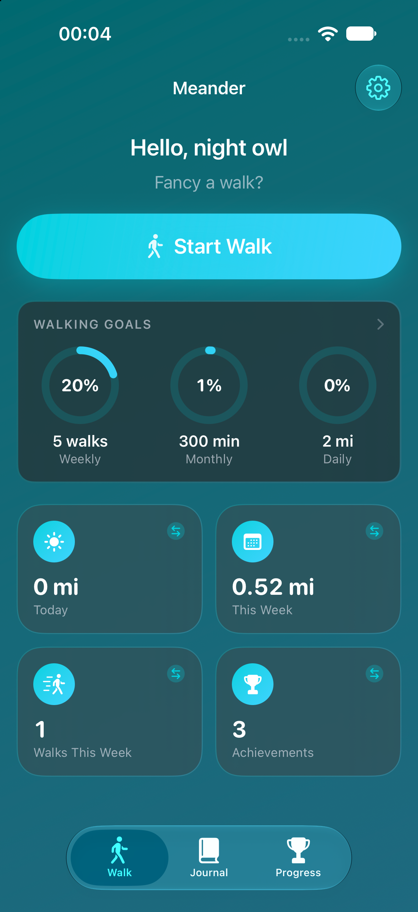

### During a walk

  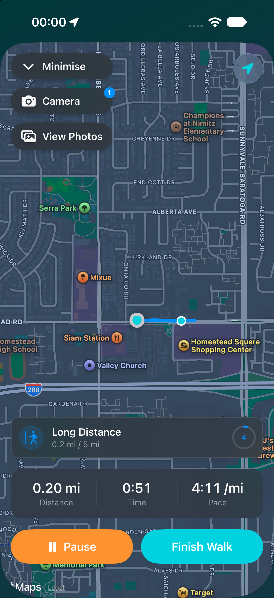
  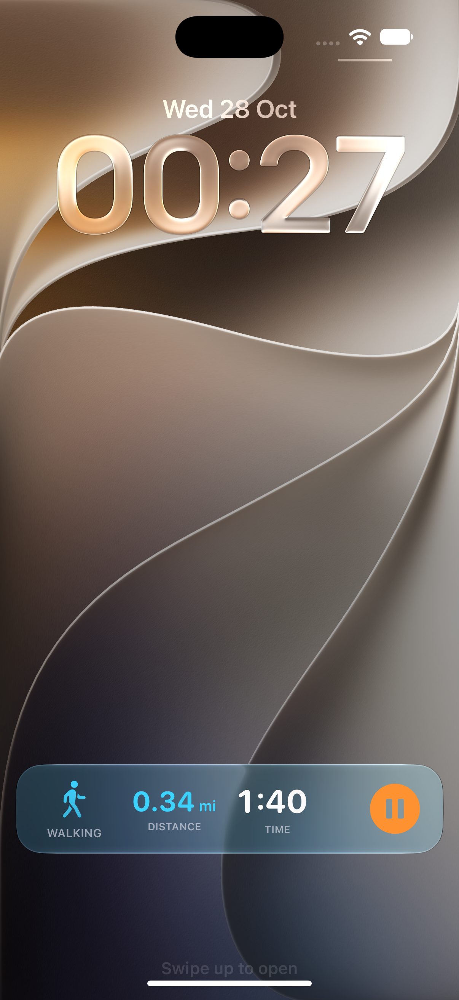

- **Pause** if you stop for a while, and **Resume** when you set off again.
  Paused time doesn't count towards your walk.
- **Take a photo** with the camera button. Photos are saved with the walk and
  appear on its map, where you took them. You can add a caption to each.
- **Minimise** (Pro) to use the rest of the app while your walk keeps tracking.
- With **Live Activities** (Pro), your walk shows on the Lock Screen and in the
  Dynamic Island.
- With **Audio Feedback** (Pro), Meander can speak your distance, pace and
  milestones as you go.
- With **Walk Challenges** (Pro), you may get a fun, random challenge during
  your walk.

- **Photo reminders** nudge you to snap a photo every mile or kilometre: a
  card when Meander's open, or a notification on the Lock Screen. With Pro,
  choose the distance in Settings ▸ Notifications. Switch them off there too.

On the free plan, each walk can have up to **3 photos**.

### Finishing

Tap **Finish Walk**, then **View & Save Walk** to see your summary: your
route with the photos you took, your distance, time and pace, and how far
the walk moves your goals. Tap **Save** to keep it, or **Discard** if you
didn't mean to record it.

  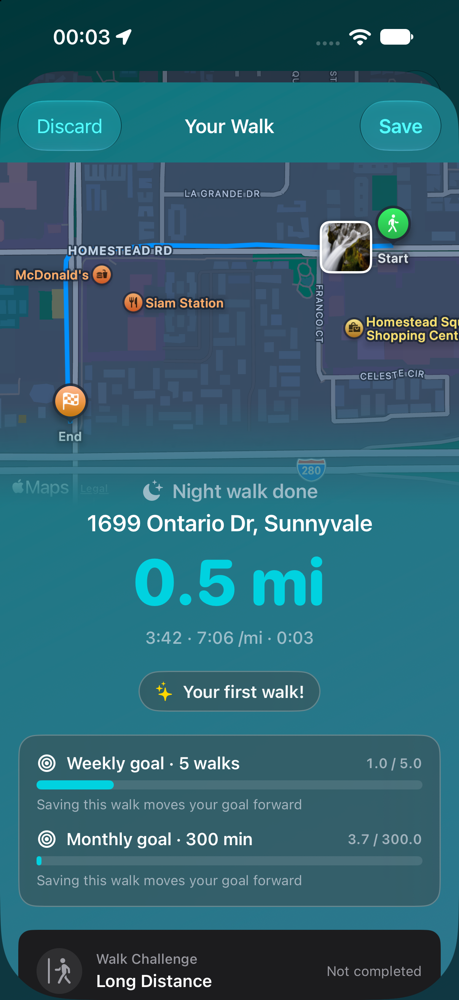

If Meander was closed during a walk, you'll see **Walk Interrupted** when you
return, with the option to carry on. The time shown includes the time the app
was closed.

### Nearby wanders

The Walk tab can suggest scenic places near you to walk. Switch this on or off
in Settings ▸ Scenic suggestions.

---

## Your Journal

The **Journal** tab is your walking diary.

- **Walks** — every walk, newest first (grouped by month if you like). Tap one
  to see its route, stats and photos. To delete a walk, open it and choose
  **Delete Walk**.
- **Photos** — every photo from your walks. With **Photo Stream** (Pro), view
  them as a grid, on a map, or as a timeline, and filter by place or
  favourites.
- **Places** — the areas you've walked in, with the walks from each.

  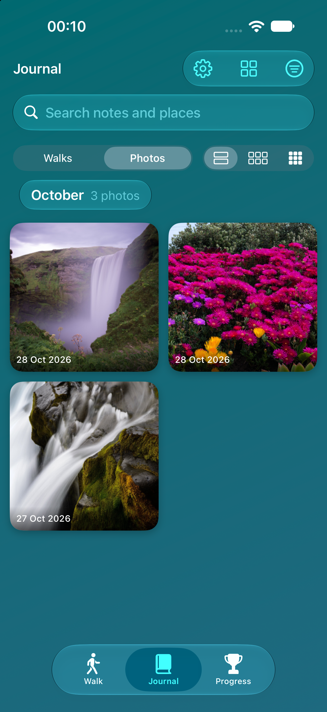
  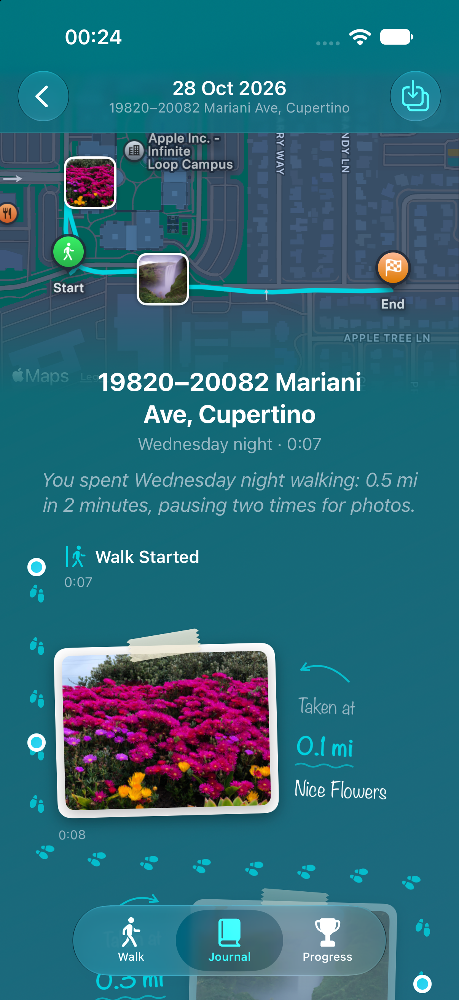

### Photo Stream (Pro)

Switch to **Photos** at the top of the Journal to see every photo from every
walk in one place, grouped by month.

**Sorting and filtering.** Tap the filter button to choose how your photos are
shown:

- **Favourites only** — just the photos you've marked with a heart (see below)
- **Newest First** or **Oldest First**
- **By Distance** — photos from your longest walks first
- **By Location** — A to Z by the place each walk was in
- **Place** — only the photos from one place you've walked

You can also search your notes and places with the search bar.

  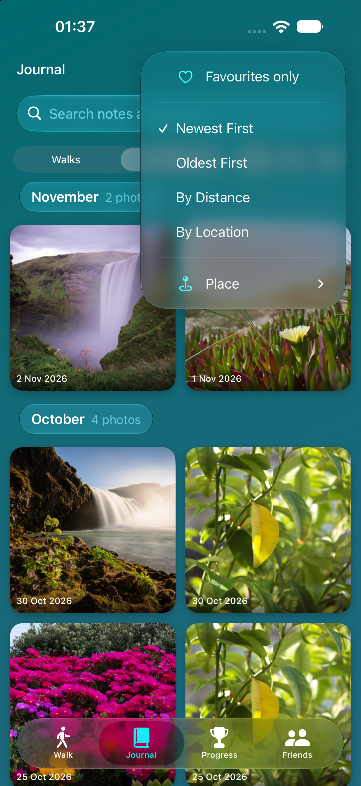

**Viewing a photo.** Tap any photo to open it full screen. Swipe, or use the
arrows at the bottom, to move between photos; the counter at the top shows
where you are.

- **♡ Favourite** — tap the heart at the top to mark a photo as a favourite.
  Tap it again to remove it. Favourites are what **Favourites only** shows.
- **•••** — **Add Caption** (or edit one), **Save to Photos** to keep a copy in
  your iPhone's Photos app, or **Delete** the photo from your walk.
- **ⓘ** — the photo's details: when it was taken, the walk's distance and
  time, how far into the walk you were, and where it was taken.

  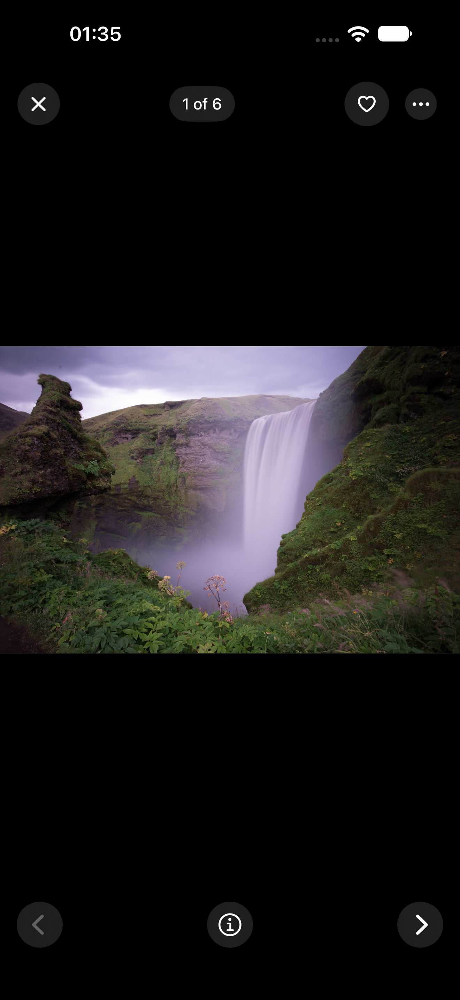
  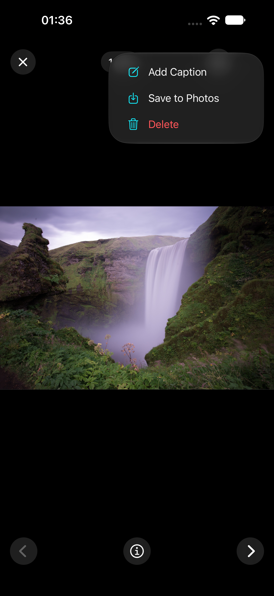
  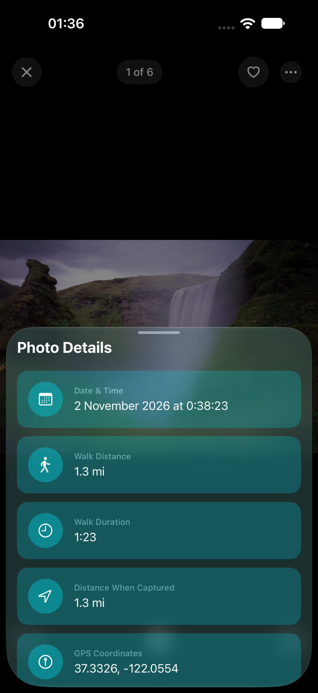

---

## Progress

The **Progress** tab shows how far you've come.

- **Level and points** — every walk earns points, and so do photos,
  achievements, goals, streaks, distance milestones, walk challenges and group
  challenges. They add up to your level. Tap your level to see where your
  points came from.
- **Achievements** — medals for milestones, streaks and special walks. Tap one
  to see what it's for. Pro adds more to earn.
- **Walking goals** — set daily, weekly or monthly goals and track them with a
  ring.
- **Charts** — your walking over time. **Detailed Analytics** (Pro) adds more
  stats and trends.
- **Monthly Recaps** (Pro) — a look back at each month of wandering.

  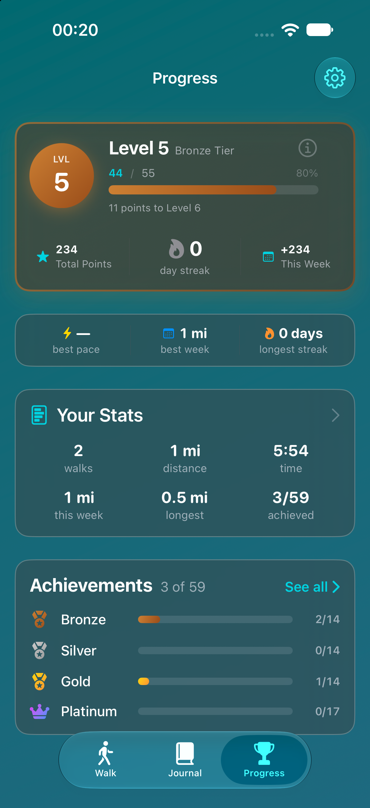
  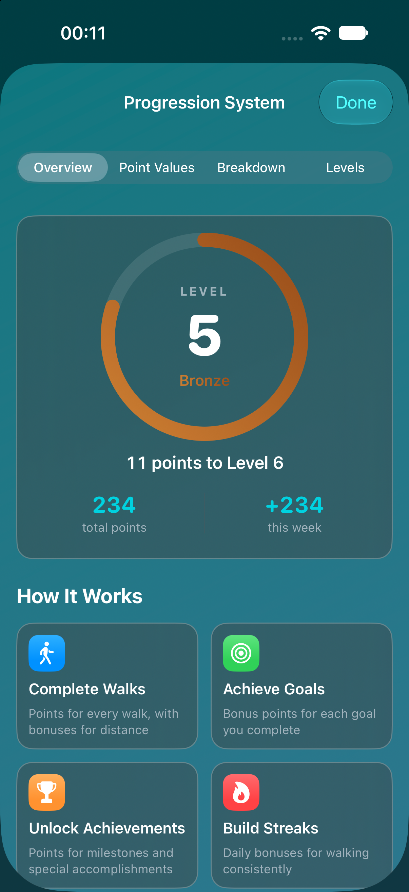

  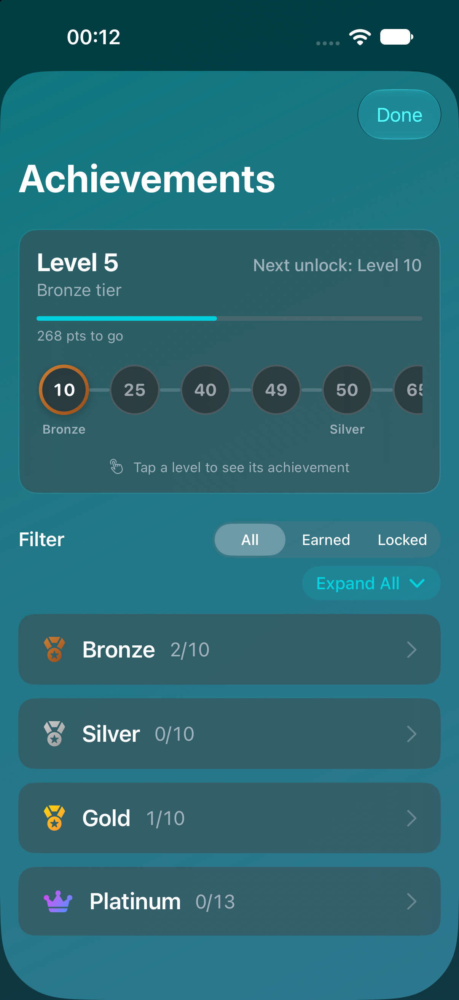
  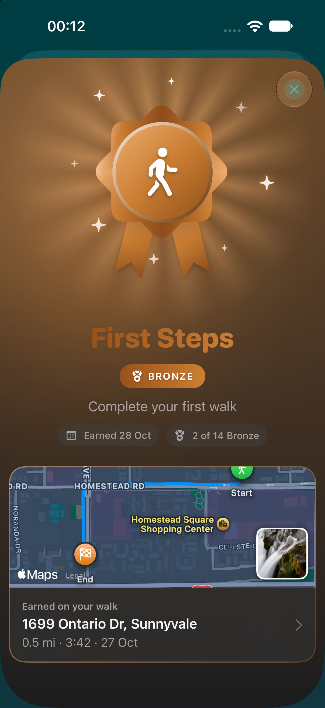
  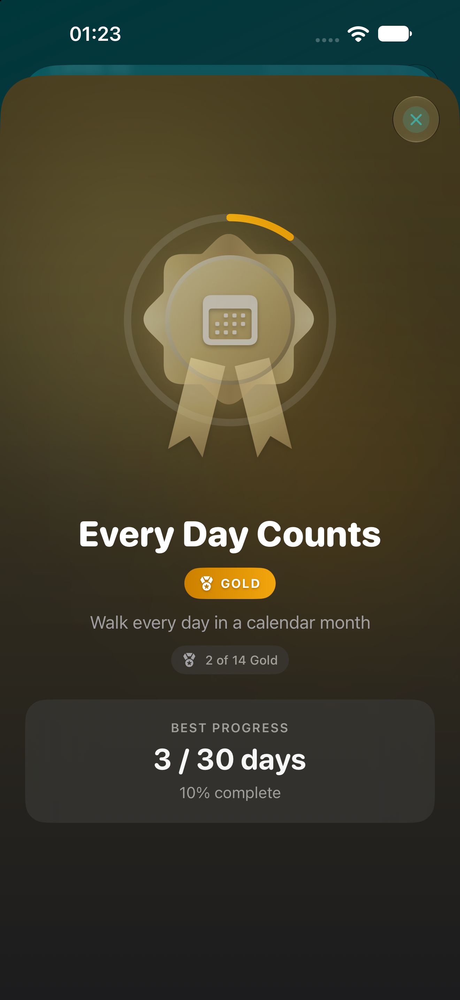

---

## Friends

Friends lets you share your walking stats with people you invite. Nothing is
shared until you invite someone or accept an invite.

### Inviting a friend

1. Open the **Friends** tab and tap **Invite a Friend**.
2. Send the link by Messages, email or any app.
3. When they open it in Meander, they can see your card.
4. They can **Share Back** so you see theirs too.

On the free plan you can see **1 friend**; Pro shows them all.

### What friends see

Only what you choose in **Settings ▸ Friends**:

- **What I Share** — the stats you tick, such as distance this week
- **Your level**, if you leave it on
- **Your name** and **profile photo**, if you add them

Friends **never** see your routes, maps or locations.

### Activity

Switch on **Share My Activity** in Settings ▸ Friends to show friends your walks,
achievements and new levels from the last 30 days. **Include Photos** adds up
to four photos from each walk. Routes and locations are never included.

### Rankings

The **Rankings** page puts you and your friends in order by any stat you all
share.

### Pausing and ending

- **Share My Stats** off pauses sharing. Friends see that you've paused, and
  you still see their stats.
- **Unfriend** someone from their page or **Manage Friends**.
- **Stop Sharing** ends every friendship and deletes your Friends card.

---

## Groups

A group (Pro) is a small circle of friends with a shared leaderboard and a
walking challenge. Open the **Groups** page on the Friends tab.

### Creating a group

1. Tap **New Group**, give it a name and an emoji.
2. Pick a challenge and how long it runs.
3. Invite friends to join.

### Challenges

- **Together** challenges add up everyone's walking towards one target, such as
  a distance, a number of walks or photos.
- **Each** challenges give everyone their own target, such as walking days or a
  streak.

A challenge runs for **a full week or month from when it's picked**, not the
calendar week or month. Only walks after the challenge starts count, and only
from when each person joined the group.

### Rewards

When a challenge is completed, everyone who took part earns points towards
their level. In a together challenge, you need to have walked at least once
during it. In an each challenge, you earn the reward when you reach your
target, plus a bonus if everyone does.

The creator can pick a new challenge at any time with **Change Challenge**;
rewards from the last one are still given.

### Members

- **Add Friend** on a member who isn't your friend sends them a request.
- The creator can **Invite Friends**, **Remove Member** and **Close Group**.
- Anyone can **Leave Group**.

Everyone in a group, friends or not, sees each member's name, level, stats and
challenge progress.

---

## Meander Pro

Meander Pro is a monthly subscription that unlocks:

- Live Activities and Minimise Walks
- Unlimited photos on every walk
- Photo Stream and the Meander Album in your Photos app
- Detailed Analytics and Monthly Recaps
- More achievements, Walk Challenges and Audio Feedback
- Exclusive themes and the large Home Screen widget
- All your friends, and Groups

To subscribe, open **Settings ▸ Unlock Meander Pro**. To cancel, use the iPhone
**Settings ▸ [your name] ▸ Subscriptions ▸ Meander**. On a new device, tap
**Restore** on the Meander Pro screen.

If Pro ends, everything you've recorded stays. Your groups stop updating (others
see you as "Not updating") until you renew, and you can still leave them.

---

## Settings

Open Settings from the gear at the top right of any tab. The main sections:

- **Appearance** — themes and colours
- **Journal** — how your walks are listed
- **Units** — miles or kilometres
- **Walk Tab Stats** — which stats appear on the Walk tab
- **Live Activity** — what shows on the Lock Screen
- **Walk Challenges** and **Audio Feedback** — during-walk extras
- **Notifications** — daily reminders, weekly summaries and photo reminders
- **Friends** — what you share, your name and photo, Manage Friends
- **Apple Health** — saving walks to Health
- **iCloud Sync** — sync status for your walks and photos
- **About** — this guide, feedback, and the privacy policy

### Themes

Under **Appearance**, pick a theme to change Meander's colours across the
app. Pro adds exclusive themes.

  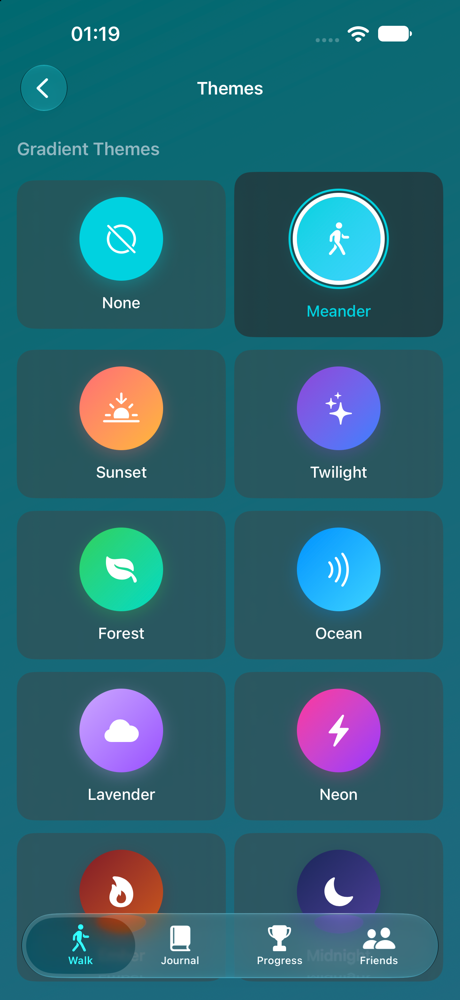

  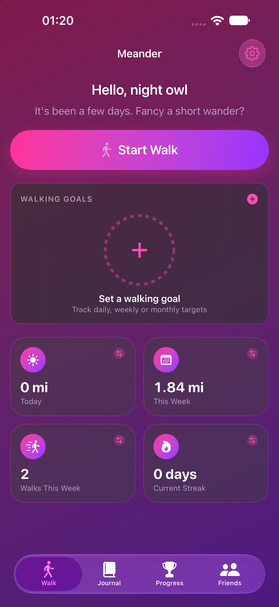
  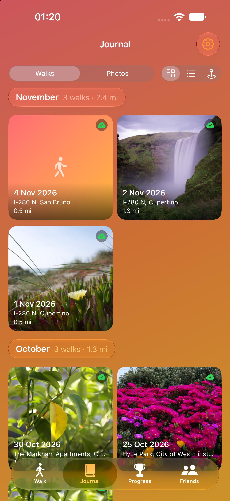
  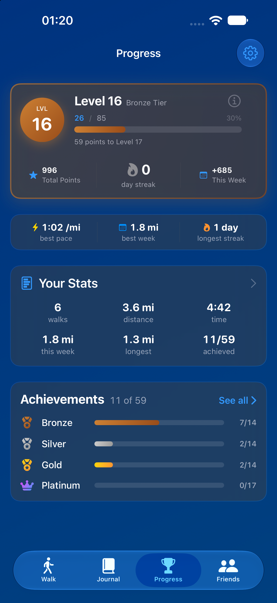

---

## iCloud and your data

Your walks, photos and progress are kept on your iPhone and synced to **your own
private iCloud account**. The developer of Meander can't see any of it.

- On a new iPhone, sign in with the same Apple Account and your history comes
  back, including Friends and groups.
- Walk photos use your iCloud storage. Walks themselves are tiny.
- Settings stay on each device.

See the [Privacy Policy](https://garrethboyd.github.io/meander-privacy/) for full details.

---

## Troubleshooting

**A friend's stats aren't updating.**
Pull down on the Friends tab to refresh. If they've paused sharing, you'll see
"Paused sharing". Their app needs to have been opened since their last walk.

**A group member shows "Updating…".**
Their app hasn't sent their progress for this challenge yet. It will once they
open Meander.

**A group member shows "Not updating".**
Their Meander Pro has ended, so their progress has stopped until they renew.

**My walks or photos aren't on my new iPhone.**
Check you're signed in to the same Apple Account, and that iCloud is on for
Meander in **Settings ▸ [your name] ▸ iCloud ▸ Apps Using iCloud**. Photos can
take a few minutes to download.

**Photos say "will sync later".**
Your walk is saved. Photos upload the next time you have a connection.

**I use Meander on two devices.**
Your Friends choices (name, what you share) are kept on each device, so set
them the same on both.

**Walks aren't appearing in Apple Health.**
Check **Settings ▸ Health ▸ Data Access & Devices ▸ Meander** and allow Meander
to write workouts.

---

## Getting help

Email **GBMeander@proton.me**, or use **Send Feedback** in Meander's Settings,
which fills in your app and iOS versions for you.
